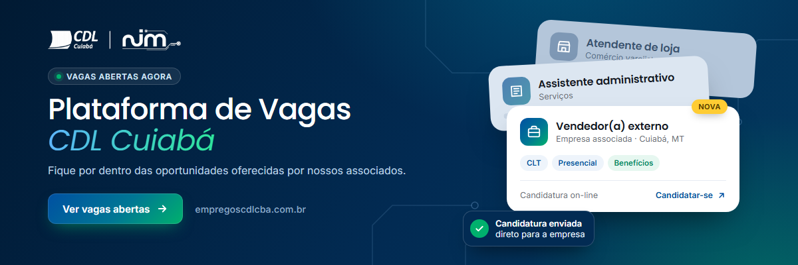

# Banner · Plataforma de Vagas

Banner para publicação em sites parceiros, que leva o usuário à listagem de vagas.

| Arquivo | Uso |
|---|---|
| `banner-vagas.png` | 1200 × 400 px (3:1). Versão padrão para publicar. |
| `banner-vagas@2x.png` | 2400 × 800 px. Para telas de alta densidade (retina). |
| `banner-vagas.html` | Arquivo-fonte do banner. Edite aqui e gere os PNGs de novo. |
| `banner-vagas-reels.png` | 1080 × 1920 px (9:16). Versão vertical para Reels e Stories do Instagram. |
| `banner-vagas-reels.html` | Arquivo-fonte da versão Reels. |
| `logo-branca.png` | Logo CDL Cuiabá | NIM em branco, usada pelo banner. |

**Link de destino:** `https://empregoscdlcba.com.br/vagas/oportunidade.html`

Exemplo de publicação:

```html
<a href="https://empregoscdlcba.com.br/vagas/oportunidade.html" target="_blank" rel="noopener">
  
</a>
```

## Estilo

Segue o guia do `index.html`: fontes Poppins (títulos) e Inter (texto), fundo `--rodape-bg`/`--sidebar-bg`, botão com `--gradiente` (azul royal → azul petróleo → verde esmeralda) e destaque em itálico no nome "CDL Cuiabá".

## Gerar os PNGs de novo (PowerShell, nesta pasta)

```powershell
$d = (Resolve-Path ".").Path; $u = "file:///" + ($d -replace '\','/') + "/banner-vagas.html"
$e = "C:\Program Files (x86)\Microsoft\Edge\Application\msedge.exe"
& $e --headless=new --hide-scrollbars --window-size=1200,400 --virtual-time-budget=5000 --screenshot="$d\banner-vagas.png" $u
& $e --headless=new --hide-scrollbars --window-size=1200,400 --force-device-scale-factor=2 --virtual-time-budget=5000 --screenshot="$d\banner-vagas@2x.png" $u
```

### Versão Reels (1080 × 1920)

```powershell
$d = (Resolve-Path ".").Path; $u = "file:///" + ($d -replace '\','/') + "/banner-vagas-reels.html"
$e = "C:\Program Files (x86)\Microsoft\Edge\Application\msedge.exe"
& $e --headless=new --hide-scrollbars --window-size=1080,1920 --virtual-time-budget=5000 --screenshot="$d\banner-vagas-reels.png" $u
```

O topo (~220 px) e a base (~300 px) ficam sem texto nem botão, porque o Instagram cobre essas faixas com a própria interface.
